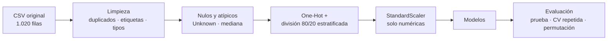

# 🫀 Predicción de enfermedad cardíaca con Machine Learning

> Un proyecto de ciencia de datos de principio a fin: limpiar un dataset clínico imperfecto, entrenar cuatro modelos, evaluarlos con rigor... y descubrir, con evidencia, que **los datos disponibles no alcanzan**.

**Autor:** Juan Fernando Linares Díaz · Proyecto final

---

## 🎯 En una frase

¿Se puede predecir si un paciente tiene enfermedad cardíaca usando solo variables clínicas básicas? En este dataset, **ningún modelo logró superar al azar**, y ese resultado negativo, bien demostrado, es la conclusión del proyecto: hacen falta **más variables y una base de datos más robusta**.

## 📌 Resumen rápido (TL;DR)

| | |
|---|---|
| **Problema** | Clasificación binaria: ¿hay enfermedad cardíaca (1) o no (0)? |
| **Datos** | 1.020 registros × 10 columnas, con nulos, duplicados, etiquetas inconsistentes y valores atípicos |
| **Muestra final** | 769 pacientes (615 de entrenamiento, 154 de prueba) |
| **Modelos** | Regresión logística (×2), Random Forest, XGBoost (fijo y ajustado) |
| **Métrica clave** | Recall (en un contexto clínico, no detectar a un enfermo es lo más grave), acompañado de AUC-ROC |
| **Resultado** | AUC-ROC entre 0,475 y 0,517 en prueba: indistinguible del azar |
| **Conclusión** | El método funciona; los datos no tienen señal suficiente |

---

## 🩺 El problema

Las enfermedades cardiovasculares son una de las principales causas de muerte en el mundo y en Colombia. En la práctica, el médico combina síntomas (tipo de dolor torácico) con mediciones objetivas (presión arterial, colesterol, frecuencia cardíaca máxima, depresión del segmento ST). Un modelo de ML podría aprender de casos previos qué combinaciones se asocian con la enfermedad y servir **como apoyo a la decisión clínica, nunca como reemplazo del diagnóstico**.

**Pregunta de investigación:** ¿es posible predecir la presencia de enfermedad cardíaca con una sensibilidad (recall) aceptable usando variables clínicas básicas? ¿Cuáles aportan más al resultado?

## 🗂️ El dataset

`Dataset_pacientes_cardiacos.csv`: 1.020 filas y 10 columnas. Se eligió porque mezcla variables numéricas y categóricas y porque trae las imperfecciones de un caso real.

| Variable | Tipo | Descripción |
|---|---|---|
| `Age` | Numérica | Edad (30 a 89 años); llegaba como texto |
| `Gender` | Categórica | Sexo |
| `Chest_Pain_Type` | Categórica | Tipo de dolor torácico |
| `Resting_BP_mmHg` | Numérica | Presión arterial en reposo |
| `Cholesterol_mg/dl` | Numérica | Colesterol en sangre |
| `Max_Heart_Rate` | Numérica | Frecuencia cardíaca máxima |
| `ST_Depression` | Numérica | Depresión del segmento ST en la prueba de esfuerzo |
| `Exercise_Induced_Angina` | Categórica | Angina inducida por ejercicio |
| `Heart_Disease` | Objetivo | 0 = sin enfermedad, 1 = con enfermedad |
| `Patient_ID` | Identificador | Se descarta del modelado |

### Los problemas que traía

- **Nulos:** entre 21 % y 23 % en `Gender`, `Chest_Pain_Type`, `Exercise_Induced_Angina` y `Heart_Disease`; entre 1,5 % y 2,5 % en el resto.
- **20 registros duplicados.**
- **Etiquetas inconsistentes:** `male`, `Female`, `Male`, `FEMALE`; `Yes`, `yes`, `No`, `NO`; y `Heart_Disease` mezclaba números y texto (`zero`, `one`, `1`).
- **Valores atípicos:** colesterol de hasta 977 mg/dl, frecuencia cardíaca máxima de 297 lpm y presión de hasta 238 mmHg.

---

## 🔧 Cómo se preparó la información

1. **Limpieza.** Se eliminaron los duplicados, se normalizaron las etiquetas (`str.strip().str.title()`) y se corrigieron los tipos de dato.
2. **Variable objetivo.** Se eliminaron los registros sin `Heart_Disease`: es la respuesta y no se puede inventar. Quedaron 769 pacientes.
3. **Nulos categóricos.** Se rellenaron con una categoría explícita `Unknown`, porque son demasiados (≈ 22 %) para eliminarlos o imputarlos sin sesgo.
4. **Nulos numéricos.** Se imputaron con la mediana, que es robusta a valores extremos y afecta pocos registros.
5. **Valores atípicos, con criterio clínico.** Se distinguió entre errores de registro y valores extremos pero posibles:
   - **Se reemplazaron** (pasan a nulo y luego a mediana): frecuencia cardíaca máxima > 220 lpm (10 registros; incompatible con la regla 220 − edad) y colesterol > 600 mg/dl (5 registros). En total, 12 registros distintos (≈ 1,6 %).
   - **Se conservaron:** presión de hasta 238 mmHg (posible en una crisis hipertensiva), `ST_Depression` entre −2,2 y 4,1 y colesterol bajo.
6. **Codificación.** One-Hot para las variables nominales.
7. **División.** 80 % entrenamiento y 20 % prueba, estratificada para conservar la proporción de enfermos (`random_state=42`).
8. **Escalado.** `StandardScaler` solo sobre las 5 variables numéricas y ajustado **únicamente con el entrenamiento**, para no filtrar información de la prueba (*data leakage*). Se usa en la regresión logística; los modelos de árboles no dependen de la escala.

---

## 🤖 Los modelos

| Modelo | Datos | Detalle |
|---|---|---|
| **Regresión logística 1** | Escalados | Incluye la categoría `Unknown` |
| **Random Forest** | Sin escalar | 300 árboles, profundidad máxima 5 y hoja mínima de 10 para limitar el sobreajuste |
| **XGBoost** | Sin escalar | Sugerido por el profesor; hiperparámetros conservadores fijados de antemano |
| **XGBoost ajustado** | Sin escalar | `RandomizedSearchCV`: 50 combinaciones, validación cruzada de 5 particiones, AUC-ROC como criterio |
| **Regresión logística 2** | Escalados | Sin los pacientes con `Unknown` (quedan 375); se evalúa en una prueba de 75 pacientes |

Además se incluye una **referencia ingenua** que predice "enfermo" a todos los pacientes. Sirve para saber si un modelo aporta algo: debe superarla.

---

## 📊 Resultados

Conjunto de prueba (154 pacientes; la regresión logística 2 usa 75):

| Modelo | Accuracy | Precision | Recall | F1 | AUC-ROC | AUC-ROC (entrenamiento) |
|---|---|---|---|---|---|---|
| Regresión logística 1 | 0,494 | 0,506 | 0,570 | 0,536 | 0,475 | 0,587 |
| Random Forest | 0,494 | 0,506 | 0,570 | 0,536 | 0,482 | 0,849 |
| XGBoost | 0,494 | 0,506 | 0,506 | 0,506 | 0,506 | 0,900 |
| XGBoost ajustado | 0,506 | 0,519 | 0,532 | 0,525 | 0,494 | 0,853 |
| Regresión logística 2 (75 pacientes) | 0,507 | 0,500 | 0,595 | 0,543 | 0,517 | 0,605 |
| *Referencia (predice "enfermo" a todos)* | *0,513* | *0,513* | *1,000* | *0,678* | *0,500* | n. a. |

### Qué dicen estos números

- **Todos rinden como el azar.** Los modelos aciertan prácticamente lo mismo que la referencia (76 a 78 de 154 pacientes frente a 79; la regresión logística 2, 38 de 75 frente a 37), y el AUC-ROC de todos está cerca de 0,5. Con 154 pacientes el margen de error del accuracy es de ≈ ±8 puntos, así que las diferencias entre modelos son ruido.
- **El recall engaña.** La regresión logística 1 y el Random Forest detectan a 45 de los 79 enfermos (≈ 57 %), pero también dan falsa alarma a 44 de los 75 sanos (≈ 59 %); en los demás modelos pasa algo parecido. La referencia tiene recall de 1,000 sin ningún criterio, por eso el recall solo se interpreta junto con la precision.
- **Sobreajuste en los modelos de árboles.** Random Forest pasa de 0,85 en entrenamiento a 0,48 en prueba, y XGBoost de 0,90 a 0,51: memorizan el ruido y no aprenden un patrón que generalice.
- **Ajustar hiperparámetros no ayudó.** La mejor combinación subió a 0,545 en validación cruzada (frente a 0,507 ± 0,046 del XGBoost fijo), pero en prueba dio 0,494: la búsqueda se ajustó al ruido.
- **Quitar los `Unknown` tampoco ayudó de forma demostrable.** Costó 394 de los 769 pacientes y la diferencia no se distingue del ruido (AUC-ROC en validación cruzada: 0,548 ± 0,08).

### Verificación extra: ¿hay señal o no?

Como una sola división 80/20 es muy ruidosa, la sección 5.9 compara todos los modelos con **validación cruzada estratificada repetida** (5 particiones × 3 repeticiones, usando `Pipeline` para que el escalado y la codificación se ajusten solo con el entrenamiento de cada partición) y una **prueba de permutación** (100 barajadas aleatorias de las etiquetas) que comprueba si el AUC-ROC real supera al que se obtiene cuando no existe ninguna relación entre las variables y la enfermedad.

---

## 💡 Conclusión

Este es un **resultado negativo bien fundamentado**, y eso también es ciencia de datos.

- ✅ **Lo que se puede afirmar:** con estas 8 variables y estos 769 pacientes, ningún modelo (lineal, de árboles ni de boosting) predice la enfermedad cardíaca mejor que el azar en el conjunto de prueba. La validación cruzada de la regresión logística 2 y del XGBoost ajustado apunta en la misma dirección.
- 🔎 **Lo que sugiere:** que el problema está en los **datos** y no en el método. Para que un modelo funcione mejor hacen falta más variables clínicas y una base de datos más robusta.
- ⚠️ **Lo que NO se puede concluir:** que estas variables no sirvan para predecir enfermedad cardíaca en general. Solo que **este dataset** no contiene señal suficiente para que un modelo la encuentre.

## 🧠 Lecciones aprendidas

1. **Una métrica sola engaña.** Un recall de 1,000 parecía excelente hasta compararlo con un modelo que no aprende nada. Siempre hay que tener una referencia.
2. **Compara train vs. test.** AUC-ROC de 0,90 en entrenamiento y 0,51 en prueba es sobreajuste evidente.
3. **Con pocos datos, una sola división miente.** La validación cruzada repetida da una estimación mucho más estable.
4. **Un buen resultado de validación cruzada puede ser suerte.** La mejor de 50 combinaciones de hiperparámetros no mejoró en prueba.
5. **Evita la fuga de datos.** Ajustar el escalador solo con el entrenamiento, y usar `Pipeline` en la validación cruzada.
6. **Los datos mandan.** Ningún algoritmo compensa variables que no contienen la información.

## ⚖️ Limitaciones

- Muestra pequeña (769 pacientes) y prueba de solo 154.
- Solo 8 variables clínicas básicas.
- Alrededor de 22 % de nulos en las variables categóricas, tratados como `Unknown`.
- La imputación con mediana de los nulos numéricos (1 % a 2,5 %) y la corrección de atípicos se hicieron sobre todo el conjunto antes de dividir. El efecto es mínimo, pero estrictamente conviene hacerlas dentro de cada partición.
- Este proyecto es académico: **no es una herramienta de diagnóstico médico**.

## 🚀 Próximos pasos

- **Más variables clínicas:** por ejemplo, glucosa en ayunas, electrocardiograma en reposo, antecedentes familiares, tabaquismo, diabetes e IMC.
- **Una base de datos más grande y más completa**, con menos nulos y registro verificado.
- **Validación externa** con datos de otra institución.
- **Ajustar el umbral de decisión** para priorizar el recall, una vez que el modelo tenga señal.
- **Interpretabilidad** (por ejemplo, SHAP) para explicar qué variables pesan en cada predicción.

---

*Hecho con curiosidad, mucha limpieza de datos y la honestidad de aceptar lo que los números dicen.*
